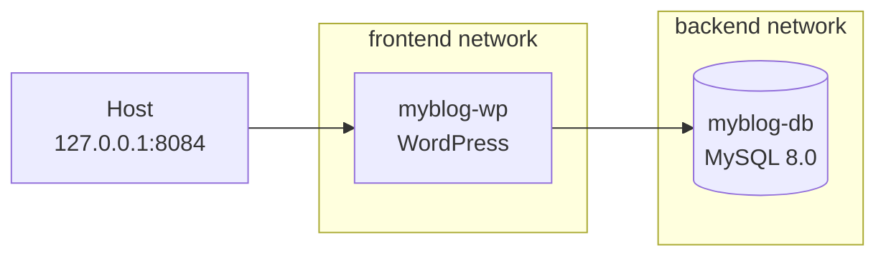

<div align="center">

# 🔐 Secure WordPress Stack with Docker Compose

**Безпечне розгортання WordPress + MySQL через Docker Compose**


🇺🇦 [Українська версія](#ua) · 🇬🇧 [English version](#en)

</div>

---

<a id="ua"></a>

# 🇺🇦 Українська версія

## 📌 Про проєкт

Навчальний проєкт із безпечного розгортання веб-стеку **WordPress + MySQL** у Docker Compose. Мета — показати практичне розуміння безпеки контейнеризації: мінімальна поверхня атаки, ізоляція сервісів, винесення секретів із коду та фаєрвол на хості з урахуванням того, як Docker працює з `iptables`.

## 🏗️ Архітектура


| Сервіс | Контейнер | Образ | Мережі |
|---|---|---|---|
| `wordpress` | `myblog-wp` | `wordpress:latest` | `frontend`, `backend` |
| `wordpress-db` | `myblog-db` | `mysql:8.0` | `backend` |

## 🛡️ Реалізовані заходи безпеки

| Область | Що зроблено |
|---|---|
| **Мінімальна поверхня атаки** | Сайт опубліковано лише на `127.0.0.1:8084`, тож напряму з мережі він недоступний |
| **Ізоляція бази даних** | `myblog-db` не публікує жодних портів на хост і підключений лише до мережі `backend` |
| **Розділення мереж** | Окремі мережі `frontend` та `backend`; WordPress має доступ до обох, база даних лише до `backend` |
| **Секрети поза кодом** | Усі паролі та назва БД задаються через змінні `.env`, у репозиторії лише `.env.example` |
| **Захист від ескалації привілеїв** | `no-new-privileges:true` для обох контейнерів |
| **Обмеження capabilities** | У WordPress вилучено `NET_RAW`, `SYS_ADMIN`, `MAC_ADMIN` |
| **Захищена конфігурація PHP** | Власний `php-custom.ini` змонтовано в режимі лише для читання (`:ro`) <!-- ✏️ Вкажіть, що саме змінено у php-custom.ini, наприклад ліміти завантаження --> |
| **Персистентність даних** | Іменовані томи `wordpress_db` та `wordpress_files` |
| **Автоперезапуск** | `restart: unless-stopped` |
| **Фаєрвол хоста** | UFW: `deny incoming`, `allow outgoing`, дозволено лише SSH |
| **Фаєрвол Docker** | Правила в ланцюгу `DOCKER-USER`, бо Docker додає власні правила в `iptables` в обхід UFW <!-- ✏️ Вкажіть, чи використовуєте скрипт firewall/setup.sh --> |

## 🔧 Відомі обмеження та план покращень

Проєкт навмисно не видає себе за production-ready. Що ще можна зміцнити:

- [ ] Зафіксувати версії образів (`wordpress:6.x-apache`, `mysql:8.0.x`) замість `wordpress:latest`
- [ ] Зробити мережу `backend` внутрішньою (`internal: true`), щоб база даних не мала виходу в інтернет
- [ ] Застосувати `cap_drop: ALL` до обох контейнерів і додати назад лише потрібні capabilities
- [ ] Додати `healthcheck` для MySQL та `depends_on` з умовою `service_healthy`
- [ ] Додати ліміти CPU та пам'яті (`deploy.resources.limits` або `mem_limit` / `cpus`)
- [ ] Перейти з паролів у `.env` на Docker secrets (`*_FILE`)
- [ ] Перевірити, чи потрібен `mysql_native_password`, адже це менш безпечний метод автентифікації
- [ ] Додати HTTPS через reverse proxy з TLS

## 📂 Структура проєкту

```plaintext
secure-wordpress-docker/
├── docker-compose.yml   # Сервіси, мережі та обмеження
├── php-custom.ini       # Власні налаштування PHP (монтується :ro)
├── .env.example         # Шаблон змінних середовища
├── .gitignore           # Виключає .env з репозиторію
├── firewall/            # Налаштування фаєрвола <!-- ✏️ Приберіть, якщо папки немає -->
└── README.md
```

## 🚀 Розгортання

**1. Склонуйте репозиторій:**

```bash
git clone https://github.com/your-username/secure-wordpress-docker.git
cd secure-wordpress-docker
```

**2. Створіть `.env` із шаблону та задайте власні паролі:**

```bash
cp .env.example .env
nano .env
```

Приклад `.env.example`:

```env
MYSQL_ROOT_PASSWORD=change_me_root
MYSQL_DATABASE=wordpress
MYSQL_USER=wp_user
MYSQL_PASSWORD=change_me_user
WORDPRESS_TABLE_PREFIX=wp_
```

> ⚠️ Ніколи не додавайте `.env` у Git. Використовуйте довгі унікальні паролі.

**3. Запустіть стек:**

```bash
docker compose up -d
docker compose ps
```

**4. Відкрийте сайт** на `http://127.0.0.1:8084` і завершіть початкове налаштування WordPress.

> 💡 Щоб зайти з іншого комп'ютера, не відкриваючи порт назовні, використайте SSH-тунель:
> `ssh -L 8084:127.0.0.1:8084 user@server`, після чого відкрийте `http://127.0.0.1:8084` у своєму браузері.

## 🔥 Фаєрвол

Порт `8084` уже прив'язано до `127.0.0.1`, тому фаєрвол є **другим рівнем захисту**:

```bash
sudo ufw default deny incoming
sudo ufw default allow outgoing
sudo ufw allow ssh        # спочатку SSH, потім enable
sudo ufw enable
```

Docker публікує порти через `iptables` повз UFW, тому для опублікованих портів контейнерів додатково використовується ланцюг `DOCKER-USER`.

## 🧪 Тестування безпеки

Відмічайте пункти після власної перевірки:

- [ ] `docker compose ps`: обидва контейнери у стані `Up`
- [ ] `ss -tuln | grep 8084`: порт слухає лише `127.0.0.1`
- [ ] `docker port myblog-db`: вивід порожній (база не опублікована)
- [ ] `nmap -p 8084,3306,80 <IP-хоста>` з іншої машини: порти `closed` або `filtered`
- [ ] `docker inspect myblog-wp --format '{{.HostConfig.SecurityOpt}} {{.HostConfig.CapDrop}}'`: видно `no-new-privileges` та вилучені capabilities
- [ ] `sudo ufw status verbose`: `Status: active`, `Default: deny (incoming)`
- [ ] `sudo iptables -L DOCKER-USER -n -v`: правила на місці
- [ ] `git check-ignore .env`: файл `.env` ігнорується Git

## ⚠️ Застереження

Проєкт створено в навчальних цілях для лабораторного середовища. Перед використанням у продакшені закрийте пункти зі списку обмежень, додайте HTTPS, резервне копіювання та моніторинг.

---

<a id="en"></a>

# 🇬🇧 English version

## 📌 About

An educational project on the secure deployment of a **WordPress + MySQL** web stack with Docker Compose. Its goal is to show a practical understanding of container security: a minimal attack surface, service isolation, secrets kept out of code, and a host firewall that accounts for how Docker interacts with `iptables`.

## 🏗️ Architecture



| Service | Container | Image | Networks |
|---|---|---|---|
| `wordpress` | `myblog-wp` | `wordpress:latest` | `frontend`, `backend` |
| `wordpress-db` | `myblog-db` | `mysql:8.0` | `backend` |

## 🛡️ Implemented Security Measures

| Area | What was done |
|---|---|
| **Minimal attack surface** | The site is published only on `127.0.0.1:8084`, so it is not directly reachable from the network |
| **Database isolation** | `myblog-db` publishes no ports to the host and is attached only to the `backend` network |
| **Network separation** | Separate `frontend` and `backend` networks; WordPress is on both, the database only on `backend` |
| **Secrets out of code** | All passwords and the DB name come from `.env` variables; only `.env.example` is committed |
| **Privilege escalation protection** | `no-new-privileges:true` on both containers |
| **Capability restriction** | `NET_RAW`, `SYS_ADMIN` and `MAC_ADMIN` are dropped from WordPress |
| **Hardened PHP configuration** | A custom `php-custom.ini` is mounted read-only (`:ro`) <!-- ✏️ Describe what php-custom.ini changes, e.g. upload limits --> |
| **Data persistence** | Named volumes `wordpress_db` and `wordpress_files` |
| **Auto-restart** | `restart: unless-stopped` |
| **Host firewall** | UFW: `deny incoming`, `allow outgoing`, SSH only |
| **Docker firewall** | Rules in the `DOCKER-USER` chain, because Docker adds its own `iptables` rules that bypass UFW <!-- ✏️ State whether you use the firewall/setup.sh script --> |

## 🔧 Known Limitations & Roadmap

This project does not claim to be production-ready. Areas still to harden:

- [ ] Pin image versions (`wordpress:6.x-apache`, `mysql:8.0.x`) instead of `wordpress:latest`
- [ ] Make the `backend` network internal (`internal: true`) so the database has no internet access
- [ ] Apply `cap_drop: ALL` to both containers and add back only the required capabilities
- [ ] Add a MySQL `healthcheck` and `depends_on` with the `service_healthy` condition
- [ ] Add CPU and memory limits (`deploy.resources.limits` or `mem_limit` / `cpus`)
- [ ] Move from `.env` passwords to Docker secrets (`*_FILE`)
- [ ] Check whether `mysql_native_password` is still needed, as it is a weaker authentication method
- [ ] Add HTTPS via a reverse proxy with TLS

## 📂 Project Structure

```plaintext
secure-wordpress-docker/
├── docker-compose.yml   # Services, networks and constraints
├── php-custom.ini       # Custom PHP settings (mounted :ro)
├── .env.example         # Environment variable template
├── .gitignore           # Excludes .env from the repository
├── firewall/            # Firewall setup <!-- ✏️ Remove if the folder does not exist -->
└── README.md
```

## 🚀 Deployment

**1. Clone the repository:**

```bash
git clone https://github.com/your-username/secure-wordpress-docker.git
cd secure-wordpress-docker
```

**2. Create `.env` from the template and set your own passwords:**

```bash
cp .env.example .env
nano .env
```

Example `.env.example`:

```env
MYSQL_ROOT_PASSWORD=change_me_root
MYSQL_DATABASE=wordpress
MYSQL_USER=wp_user
MYSQL_PASSWORD=change_me_user
WORDPRESS_TABLE_PREFIX=wp_
```

> ⚠️ Never commit `.env` to Git. Use long, unique passwords.

**3. Start the stack:**

```bash
docker compose up -d
docker compose ps
```

**4. Open the site** at `http://127.0.0.1:8084` and complete the initial WordPress setup.

> 💡 To access it from another computer without exposing the port, use an SSH tunnel:
> `ssh -L 8084:127.0.0.1:8084 user@server`, then open `http://127.0.0.1:8084` in your local browser.

## 🔥 Firewall

Port `8084` is already bound to `127.0.0.1`, so the firewall acts as a **second layer of defense**:

```bash
sudo ufw default deny incoming
sudo ufw default allow outgoing
sudo ufw allow ssh        # SSH first, then enable
sudo ufw enable
```

Docker publishes ports through `iptables`, bypassing UFW, so the `DOCKER-USER` chain is additionally used for published container ports.

## 🧪 Security Testing

Tick the items after verifying them yourself:

- [ ] `docker compose ps`: both containers are `Up`
- [ ] `ss -tuln | grep 8084`: the port listens on `127.0.0.1` only
- [ ] `docker port myblog-db`: empty output (the database is not published)
- [ ] `nmap -p 8084,3306,80 <host-IP>` from another machine: ports are `closed` or `filtered`
- [ ] `docker inspect myblog-wp --format '{{.HostConfig.SecurityOpt}} {{.HostConfig.CapDrop}}'`: shows `no-new-privileges` and the dropped capabilities
- [ ] `sudo ufw status verbose`: `Status: active`, `Default: deny (incoming)`
- [ ] `sudo iptables -L DOCKER-USER -n -v`: rules are in place
- [ ] `git check-ignore .env`: `.env` is ignored by Git

## ⚠️ Disclaimer

This project is built for educational purposes in a lab environment. Before production use, address the items in the limitations list and add HTTPS, backups and monitoring.